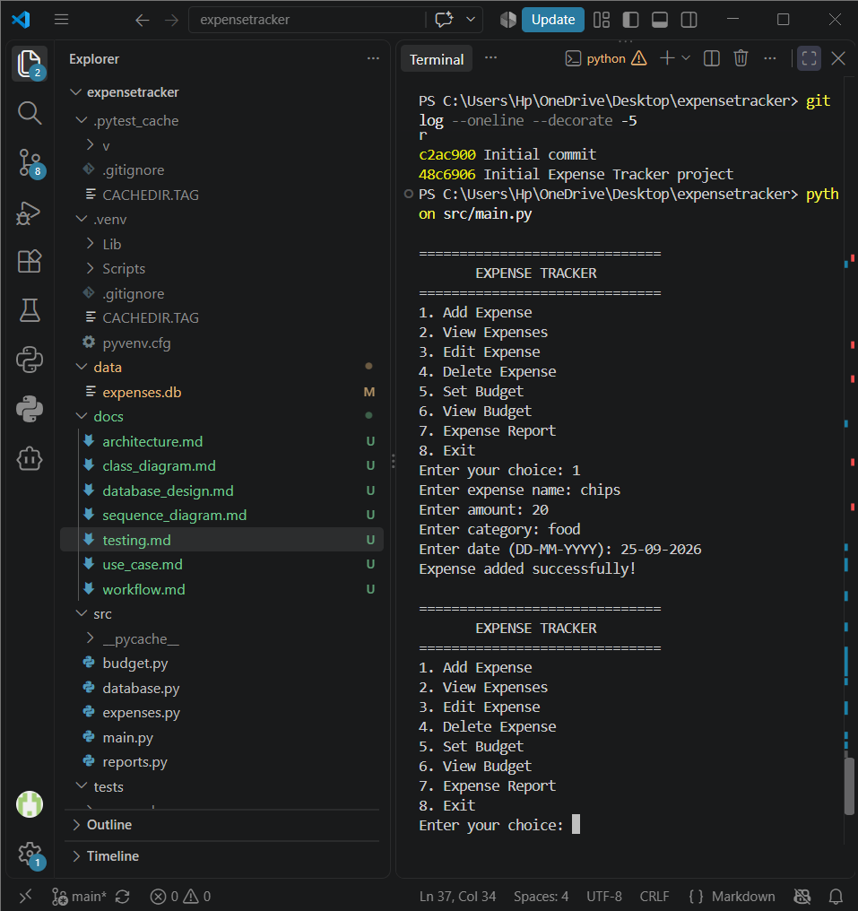

# Expense Tracker

## 1. Introduction

Expense Tracker is a simple Python-based application designed to help users
record and manage their daily expenses.

The application allows users to add, view, edit and delete expenses. It also
allows users to set a monthly budget and view a report showing total spending,
remaining budget and spending by category.

The project uses Python for the application logic and SQLite for storing
expense and budget information.

## 2. Project Objectives

The main objectives of the project are:

- To provide a simple way to record daily expenses.
- To store expense information permanently.
- To allow users to edit and delete incorrect entries.
- To help users set and monitor a monthly budget.
- To provide a basic spending report.
- To apply Python programming and database concepts in a real-world project.
## 3. Problem Statement

Students and other individuals often have small daily expenses such as food,
transportation, shopping and other personal purchases. When these expenses are
not recorded properly, it can become difficult to understand where money is
being spent and whether the monthly budget is being followed.

The Expense Tracker provides a simple solution by allowing users to record
their expenses, manage their monthly budget and view basic spending reports
from one application.

## 4. Scope

The project focuses on personal expense management.

The application includes:

- Recording daily expenses.
- Viewing stored expenses.
- Editing existing expenses.
- Deleting expenses.
- Setting a monthly budget.
- Viewing the current budget.
- Generating a basic expense report.
- Categorizing expenses.
- Storing data using SQLite.

The current project is designed as a local desktop/terminal application.
Features such as online accounts, cloud synchronization and mobile access are
outside the current scope.
## 5. Functional Requirements

The system should provide the following functions:

1. Add Expense
   - The user can enter an expense name, amount, category and date.
   - The expense is stored in the database.

2. View Expenses
   - The user can view all recorded expenses.

3. Edit Expense
   - The user can modify the details of an existing expense.

4. Delete Expense
   - The user can delete an existing expense using its ID.

5. Set Budget
   - The user can set a monthly spending budget.

6. View Budget
   - The user can view the currently saved monthly budget.

7. Expense Report
   - The system calculates total expenses.
   - The system calculates the remaining budget.
   - The system displays spending by category.

## 6. Non-Functional Requirements

### Usability
The application should have a simple menu-based interface that is easy to
understand and use.

### Reliability
Expense and budget information should be stored in the SQLite database so that
the data remains available when the application is run again.

### Error Handling
The application should handle invalid numerical input and invalid menu choices
without crashing.

### Maintainability
The project is divided into separate Python modules for expenses, budget,
reports, database management and the main program.

### Performance
The application should perform normal expense and report operations quickly
for the expected number of personal expense records.
## 7. Technologies Used

- Python 3
- SQLite
- Pytest
- Git
- GitHub
- Visual Studio Code

## 8. System Architecture

The application follows a simple modular architecture.

The user interacts with `main.py`, which provides the menu and controls the
application flow.

The main program uses separate modules for different responsibilities:

- `expenses.py` handles expense operations.
- `budget.py` handles budget operations.
- `reports.py` generates expense reports.
- `database.py` manages the SQLite database connection.
- `expenses.db` stores the application data.

### Architecture Flow

User
  |
  v
main.py
  |
  +-------------------+
  |         |         |
  v         v         v
expenses.py budget.py reports.py
  |         |         |
  +---------+---------+
            |
            v
       database.py
            |
            v
       expenses.db
## 9. Design Diagrams

The following design diagrams were created for the project:

### 9.1 Process / Workflow Diagram

The workflow shows the sequence of actions from starting the application,
selecting an option and performing an operation through the database.

### 9.2 Use Case Diagram

The use case diagram shows the main interaction between the user and the
Expense Tracker.

The user can add, view, edit and delete expenses, set and view the budget, and
generate an expense report.

### 9.3 Class / Component Diagram

The component structure separates expense management, budget management,
report generation and database management into different modules.

### 9.4 Sequence Diagram

The sequence diagram demonstrates the process of adding an expense, from user
input through the application modules to SQLite storage.

### 9.5 Database Design

The database design contains the `expenses` and `budget` tables used to store
application data.
## 10. Design Decisions and Rationale

Several simple design decisions were made while developing the project.

### Modular Python Structure

The application was divided into separate Python files so that each module
handles a specific responsibility. This makes the project easier to understand
and maintain.

### SQLite Database

SQLite was selected because it is lightweight, easy to use with Python and
does not require a separate database server. It is suitable for a local
expense tracking application.

### Menu-Based Interface

A terminal-based menu was used to keep the application simple and focus on the
main expense management functions.

### Pytest

Pytest was used for basic automated testing of the expense management
functions. This helps verify that important operations such as adding and
deleting expenses work correctly.

### Git and GitHub

Git was used to track changes during development, while GitHub was used to
store and manage the project repository.
## 11. Implementation Details

The project is divided into multiple Python modules so that each part of the
application has a clear responsibility.

### main.py

`main.py` is the main entry point of the application. It displays the menu,
takes input from the user and calls the required functions from other modules.

### database.py

`database.py` manages the SQLite database connection and creates the expenses
table when the application starts.

### expenses.py

`expenses.py` contains functions for managing expenses.

The module provides functions to:

- Add an expense.
- View expenses.
- Edit an expense.
- Delete an expense.

### budget.py

`budget.py` manages the user's monthly budget.

It provides functions to:

- Set the budget.
- Retrieve the saved budget.

### reports.py

`reports.py` generates the expense report.

It calculates:

- Total expenses.
- Remaining budget.
- Spending by category.

### Database

SQLite is used as the storage system. The database contains an `expenses`
table for individual expense records and a `budget` table for the monthly
budget.
## 12. Screenshots and Results

The application was tested by running the Expense Tracker and performing
different operations.

### 12.1 Main Menu

The main menu provides access to all major functions of the application,
including expense management, budget management and expense reports.

### 12.2 Adding an Expense

An expense was successfully added by entering its name, amount, category and
date. The application displayed a success message after storing the expense.

### 12.3 Expense Report

The expense report displays the total amount spent, the monthly budget,
remaining budget and spending by category.

### 12.4 Budget

A monthly budget was successfully saved and retrieved using the budget
management functions.

### Results

The main features of the application were successfully tested. Expenses could
be added, viewed, edited and deleted. The budget could be set and viewed, and
the expense report correctly displayed spending information.
## 13. Testing

The project was tested using both automated and manual testing.

### Automated Testing

Pytest was used to test the expense management functions.

The test file is:

`tests/test_expenses.py`

The tests check:

- Whether an expense can be added successfully.
- Whether an expense can be deleted successfully.

The tests were executed using:

`python -m pytest -v tests/test_expenses.py`

### Test Result

The final test run completed successfully:

**2 tests passed**

### Manual Testing

The following functions were also tested manually:

| Feature | Result |
|---|---|
| Add Expense | Passed |
| View Expenses | Passed |
| Edit Expense | Passed |
| Delete Expense | Passed |
| Set Budget | Passed |
| View Budget | Passed |
| Expense Report | Passed |
| Invalid Input Handling | Passed |

The testing confirmed that the main functions of the application work as
expected.
## 14. Challenges Faced

During development, some challenges were encountered:

- Understanding how Python modules communicate with each other.
- Connecting the Python application with SQLite.
- Managing database records while adding, editing and deleting expenses.
- Handling invalid user input without stopping the program.
- Setting up automated testing with pytest.
- Organizing the project into separate folders and files.
- Managing the project using Git and GitHub.

## 15. Learnings

Through this project, I learned:

- How to build a Python application using multiple modules.
- How to create and use an SQLite database.
- How SQL queries can be used to insert, update, retrieve and delete data.
- How to organize a Python project into separate files.
- How to handle errors using `try` and `except`.
- How to write basic automated tests using pytest.
- How to use Git for version control.
- How to publish a project on GitHub.
- How to document a software project.

## 16. Future Enhancements

The project can be improved in the future by adding:

- A graphical user interface.
- Monthly and yearly spending statistics.
- More detailed charts and graphs.
- Search and filtering of expenses.
- Exporting expense reports to CSV or PDF.
- User accounts and login functionality.
- Cloud-based data synchronization.
- Mobile application support.
## 17. Conclusion

The Expense Tracker successfully provides a simple way to record and manage
personal expenses. The project combines Python programming with SQLite
database concepts to provide expense management, budget tracking and basic
reporting features.

The project also demonstrates the use of modular programming, error handling,
automated testing and version control. The main features were tested
successfully, with 2 automated tests passing.

Overall, the project provided practical experience in designing, implementing,
testing and documenting a complete software application.

## 18. References

1. Python Documentation
2. SQLite Documentation
3. Pytest Documentation
4. Git Documentation
5. GitHub Documentation